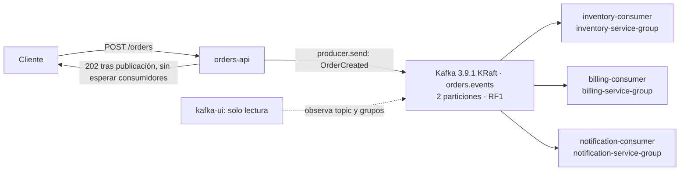

# Arquitectura basada en eventos con Kafka

Laboratorio de Pruebas de Integración de Aseguramiento de la Calidad: una API publica `OrderCreated` y tres consumidores independientes simulan inventario, facturación y notificación.

## Integrantes

- Juan David Velasquez Murillo
- Paula Andrea Calderon Quintero
- Sara Regino Ferraro
- Alejandra Madrid Calderon

## Inicio

Seguir [clonación, arranque, salud, pedido nuevo, seguimiento y parada](docs/EJECUCION.md). El sistema completo tiene seis servicios; las guías antiguas por fases no describen el montaje final.



Las acciones son simuladas, sin base de datos, cobros ni correos reales. La entrega puede repetirse entre acción y commit: no hay idempotencia de negocio, exactly-once ni alta disponibilidad.

## Estructura y lectura

```text
kafka/
├── src/                  # Productor/API y consumidores comparten seis fuentes
│   ├── app.js            # HTTP y publicación
│   ├── server.js         # Arranque del productor y topic
│   ├── order-event.js    # Contrato del evento
│   ├── consumer.js       # Núcleo y simulaciones por rol
│   ├── consumer-runtime.js
│   └── consumer-server.js
├── test/                 # Pruebas locales y comprobación estática
├── docker-compose.yml    # Seis servicios
└── Dockerfile
docs/
├── EJECUCION.md           # Recorrido reproducible completo
├── casos/                # Diez reportes y evidencia por caso
├── verificacion/         # Corridas, registros y capturas originales
└── publicacion/          # Overlay de saneamiento y validación histórica
pruebas/                  # Colecciones Postman
```

- [Índice de los diez casos](docs/casos/README.md): CP-01 y CP-04 a CP-12; resultados técnicos documentados en sus reportes, no una ejecución nueva.
- [Cierre mínimo CP-10/11/12](docs/verificacion/cierre-minimo-20261101/RESUMEN.md): cinco pedidos; vistas derivadas de CLI/JSON, no capturas GUI.
- [Saneamiento y hashes históricos](docs/publicacion/README.md): tres copias públicas saneadas, originales privados conservados; manifiestos históricos inmutables.
- [Fuentes técnicas](docs/FUENTES_TECNICAS.md).

No se ha comprobado reproducción Windows nativa. Las pruebas locales y la validación estática no sustituyen las evidencias de integración; RabbitMQ se mantiene separado.
