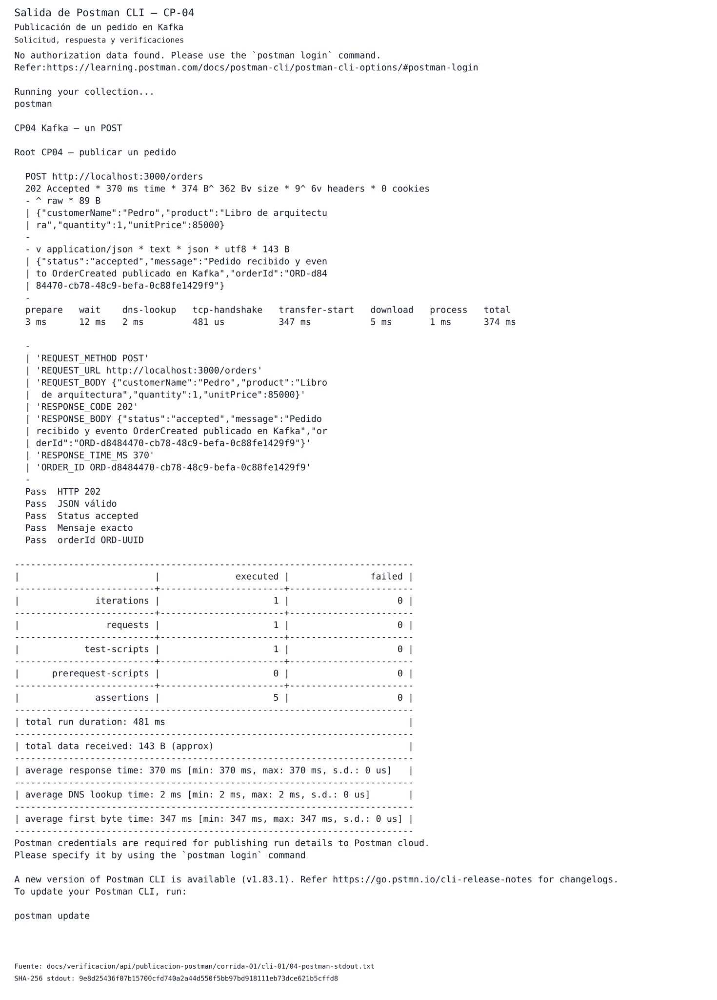

# CP-01 — Creación de pedido vía API

## ID del caso
CP-01. Evidencia de la corrida del 31 de octubre de 2026 a las 18:06:41 UTC, compartida con [CP-04](../CP04/reporteCP04.md); no es una ejecución nueva.

## Arquitectura
Kafka, endpoint de `orders-api`. El alcance aquí es la recepción del pedido y su respuesta HTTP.

## Objetivo
Validar que el endpoint recibe y responde correctamente (guía, p. 4; petición y respuesta del anexo, p. 23).

## Precondiciones
Los snapshots [previo](../../verificacion/api/publicacion-postman/corrida-01/cli-01/01-before-ps-stdout.txt) y [posterior](../../verificacion/api/publicacion-postman/corrida-01/cli-01/07-after-ps-stdout.txt) conservan seis servicios running, cinco healthy y Kafka UI sin healthcheck reportado, con los mismos IDs.
La [salud previa](../../verificacion/api/publicacion-postman/corrida-01/cli-01/02-before-health-stdout.txt) contiene `{"status":"ok"}`. El comando `curl --fail-with-body` terminó en 0; no se conservaron cabeceras para afirmar un código HTTP concreto de salud.
La [versión archivada de Postman CLI](../../verificacion/api/publicacion-postman/corrida-01/cli-01/00-postman-version-stdout.txt) identifica la herramienta utilizada.

## Datos de entrada
`POST http://localhost:3000/orders`, sin autenticación (`noauth`), cabecera `Content-Type: application/json` y cuerpo:

```json
{"customerName":"Pedro","product":"Libro de arquitectura","quantity":1,"unitPrice":85000}
```

[Request archivado](../../verificacion/api/publicacion-postman/corrida-01/cli-01/request.json) y [colección ejecutada](../../verificacion/api/publicacion-postman/corrida-01/cli-01/collection-executed.json).
El `orderId` es generado, no enviado: `ORD-d8484470-cb78-48c9-befa-0c88fe1429f9`.
El [resultado técnico archivado](../../verificacion/api/publicacion-postman/corrida-01/cli-01/result.json) vincula además `eventId=4f5ee1ac-1c2d-41e7-826b-37a13d3767a2` y `correlationId=310a36c4-8214-4406-a8b2-fce3c8c6ca55`; tampoco son datos de entrada.

## Pasos ejecutados
1. En la corrida original se registraron el estado de los servicios y la salud previa.
2. Se ejecutó la colección archivada con una iteración y un único POST del cuerpo anterior.
3. Se registraron respuesta, tiempo y cinco assertions; se archivaron stdout y stderr.
4. Para este reporte se revisaron esos archivos offline y se reutilizó su visualización, sin repetir el POST ni consultar el runtime.
Los [comandos originales con tiempos UTC](../../verificacion/api/publicacion-postman/corrida-01/cli-01/commands.json) documentan diez comandos, todos con exit code 0. El comando Postman se ejecutó entre `18:06:38.449708` y `18:06:43.398942` UTC.

## Resultado esperado
El endpoint recibe el pedido y responde HTTP 202 con JSON: `status=accepted`, mensaje `Pedido recibido y evento OrderCreated publicado en Kafka` y `orderId` generado con prefijo `ORD-` y UUID. No se agregan pruebas negativas ni umbrales de latencia al criterio de CP-01.

## Resultado obtenido
El [stdout original](../../verificacion/api/publicacion-postman/corrida-01/cli-01/04-postman-stdout.txt) registra **202 Accepted, 370 ms, una iteración, un request, cinco assertions exitosas y cero fallos**. La respuesta real, legible en el stdout, es:

```json
{"status":"accepted","message":"Pedido recibido y evento OrderCreated publicado en Kafka","orderId":"ORD-d8484470-cb78-48c9-befa-0c88fe1429f9"}
```

Las assertions comprueban HTTP 202, JSON válido, status accepted, mensaje exacto y formato ORD-UUID. El [stderr](../../verificacion/api/publicacion-postman/corrida-01/cli-01/04-postman-stderr.txt) está vacío y Postman terminó en 0.
Los avisos de credenciales/cloud y actualización permanecen visibles en el stdout; no invalidaron la ejecución local ni se ocultaron.

## Evidencia (capturas)


Salida íntegra de **Postman CLI**, compartida con CP-04. Se conserva su título original «Salida de Postman CLI — CP-04», junto con la fuente y sus hashes.
[Metadatos originales y SHA-256](../../verificacion/api/publicacion-postman/corrida-01/cli-01/visualizaciones/01-postman-cli-salida-renderizada.json): stdout `9e8d25436f07b15700cfd740a2a44d550f5bb97bd918111eb73dce621b5cffd8`; SVG `27a3c36c5e159a12b1b772669883553cc7d44818da27912d025d87a2f3ca659c`.

## Estado
**Cumple**, como conclusión técnica propia de CP-01, no calificación del profesor.
La entrega reúne **10/10 casos verificados y documentados**. Este caso acredita la recepción HTTP 202; CP-04 y CP-05 conservan sus evidencias independientes.

## Análisis técnico
La petición coincide entre request archivado, colección y consola; la respuesta confirma aceptación y devuelve el identificador generado del mismo pedido. Esto sustenta el objetivo acotado de CP-01.
El mensaje de respuesta no prueba por sí solo persistencia o consumo: CP-04 conserva su evidencia de publicación y CP-05 su corrida independiente. No se deduce consumo de este evento ni cierre de CP-06/CP-07.
Los 370 ms son una observación puntual, no un SLA ni demostración de independencia del consumidor. La validación documental es offline; no representa una nueva ejecución funcional.
El resultado técnico original se conserva sin modificaciones.
