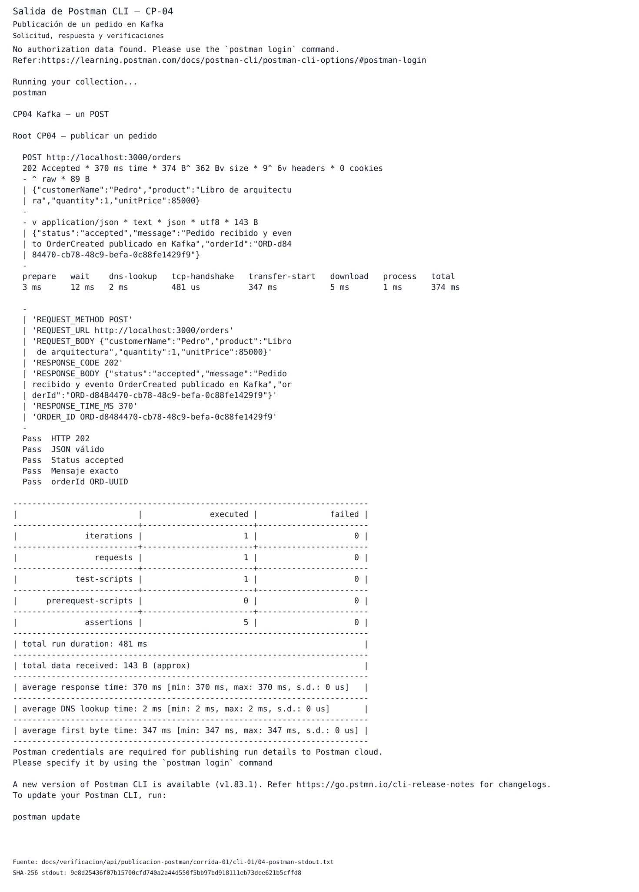
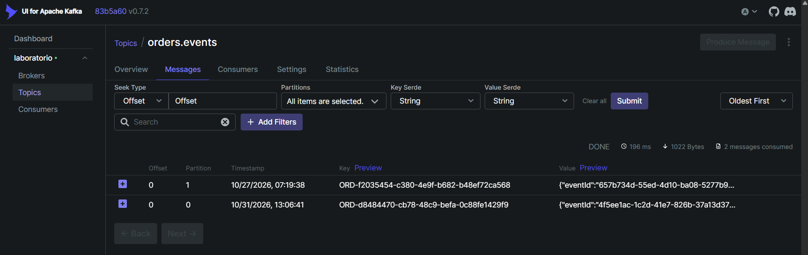
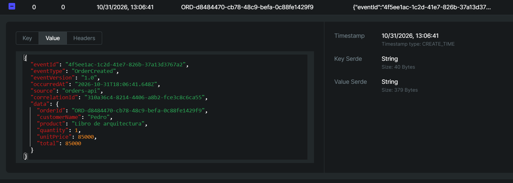

# CP-04 — Publicación de evento en Kafka

## ID del caso
CP-04. Corrida del 31 de octubre de 2026, documentada sin repetir el POST.

## Arquitectura
Kafka: `orders-api` → broker → `orders.events`; Kafka UI permite observar el registro.
Este caso acredita publicación y almacenamiento, no procesamiento de negocio.

## Objetivo
Verificar que el pedido genera `OrderCreated`, según la guía, casos y formato de p. 4 y anexo 2, apartado 11 y validación observable de pp. 23–24.

## Precondiciones
Los snapshots [antes](../../verificacion/api/publicacion-postman/corrida-01/cli-01/01-before-ps-stdout.txt) y [después](../../verificacion/api/publicacion-postman/corrida-01/cli-01/07-after-ps-stdout.txt) registran los mismos seis IDs: seis servicios running, cinco healthy y Kafka UI sin healthcheck reportado.
La [salud previa](../../verificacion/api/publicacion-postman/corrida-01/cli-01/02-before-health-stdout.txt) devuelve `{"status":"ok"}`; el comando correspondiente termina en 0. El archivo no conserva cabeceras HTTP.
Los offsets iniciales de `orders.events` son 0 para partición 0 y 1 para partición 1.

## Datos de entrada
`POST http://localhost:3000/orders`, `Content-Type: application/json`, desde Postman CLI.

```json
{"customerName":"Pedro","product":"Libro de arquitectura","quantity":1,"unitPrice":85000}
```

[Request archivado](../../verificacion/api/publicacion-postman/corrida-01/cli-01/request.json) y [colección ejecutada](../../verificacion/api/publicacion-postman/corrida-01/cli-01/collection-executed.json).
Identificadores generados:
- `orderId`: `ORD-d8484470-cb78-48c9-befa-0c88fe1429f9`.
- `eventId`: `4f5ee1ac-1c2d-41e7-826b-37a13d3767a2`.
- `correlationId`: `310a36c4-8214-4406-a8b2-fce3c8c6ca55`.
- `occurredAt`: `2026-10-31T18:06:41.648Z`; `eventVersion=1.0`, `source=orders-api`, total 85000.

## Pasos ejecutados
1. Se conservaron snapshots de servicios, salud y offsets iniciales.
2. Se ejecutó la colección con una iteración y un único request POST.
3. Se archivaron stdout de Postman CLI, offsets posteriores y log de la API.
4. Se leyó el segmento nativo de `orders.events-0` y se compararon sus identificadores.
5. Se incorporaron el listado y el detalle JSON del mismo registro en Kafka UI.
Los [comandos y tiempos archivados](../../verificacion/api/publicacion-postman/corrida-01/cli-01/commands.json) registran diez comandos con exit code 0; no se ejecutaron nuevamente para este reporte.

## Resultado esperado
Respuesta `accepted` y evento `OrderCreated` almacenado en `orders.events`, visible en Kafka UI con datos e identificadores coincidentes con la publicación de la API.

## Resultado obtenido
Postman CLI registra **HTTP 202 Accepted, 370 ms, un request, cinco assertions exitosas y cero fallos**.
La respuesta contiene `status=accepted` y el mensaje “Pedido recibido y evento OrderCreated publicado en Kafka”.
El [log de la API](../../verificacion/api/publicacion-postman/corrida-01/cli-01/06-api-logs-stdout.txt) registra los tres IDs a `2026-10-31T18:06:41.842Z`, tópico `orders.events`, partición 0 y baseOffset 0.
El [dump nativo](../../verificacion/api/publicacion-postman/corrida-01/cli-01/09-broker-native-stdout.txt) contiene el JSON completo, `isvalid: true`, key de 40 bytes y value de 379 bytes, con offset 0.

| Partición | Log-end antes | Log-end después | Delta |
| --- | --- | --- | --- |
| 0 | 0 | 1 | 1 |
| 1 | 1 | 1 | 0 |

Fuentes: [antes](../../verificacion/api/publicacion-postman/corrida-01/cli-01/03-before-offsets-stdout.txt) y [después](../../verificacion/api/publicacion-postman/corrida-01/cli-01/05-after-offsets-stdout.txt).
El log-end 1 indica la próxima posición; el registro nuevo ocupa offset 0.
El [resultado técnico](../../verificacion/api/publicacion-postman/corrida-01/cli-01/result.json) conserva su checkpoint previo `TECHNICALLY_VERIFIED_POSTMAN_SCREENSHOT_PENDING`; no se modifica retrospectivamente.

## Evidencia (capturas)

[Fuente stdout](../../verificacion/api/publicacion-postman/corrida-01/cli-01/04-postman-stdout.txt) · [metadatos y SHA-256 de la visualización](../../verificacion/api/publicacion-postman/corrida-01/cli-01/visualizaciones/01-postman-cli-salida-renderizada.json).


[Metadatos y SHA-256 del listado](../../verificacion/api/publicacion-postman/corrida-01/cli-01/capturas/01-orders-events-listado.json).


[Metadatos y SHA-256 del detalle](../../verificacion/api/publicacion-postman/corrida-01/cli-01/capturas/02-order-created-kafka-ui.json).
El listado identifica el tópico y la misma key, partición 0 y offset 0; el detalle complementario permite leer el JSON completo, key 40 B y value 379 B.
La hora visible es `10/31/2026, 13:06:41`; no se certifica su zona horaria. La lectura del visor no demuestra consumo de negocio.

## Estado
**Cumple**, como conclusión técnica propia para CP-04, no calificación del profesor.
Con CP-04 y CP-05 documentados, Kafka queda en **2/10** reportes cerrados y ocho casos pendientes. CP-05 conserva su corrida y evidencias independientes.

## Análisis técnico
La concordancia entre respuesta, metadata de la API, contenido del segmento nativo y ambas capturas identifica la misma publicación.
El avance total del log-end es un registro y coincide con el único request archivado; el contenido nativo respalda almacenamiento, no solo aceptación HTTP.
Los 370 ms describen esta solicitud y no establecen SLA. No se deducen garantías exactly-once, recuperación ni consumo funcional de este nuevo pedido; CP-05 conserva su evidencia independiente.
La verificación de este reporte fue offline: no hubo nuevos requests, reinicios ni consultas al runtime.
