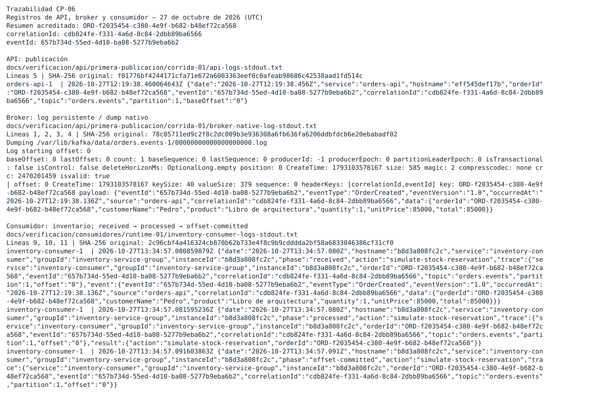
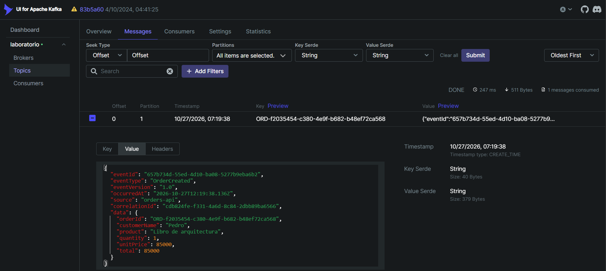
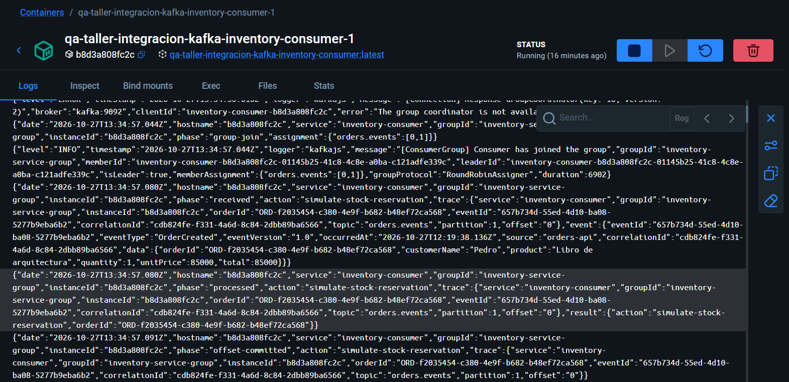
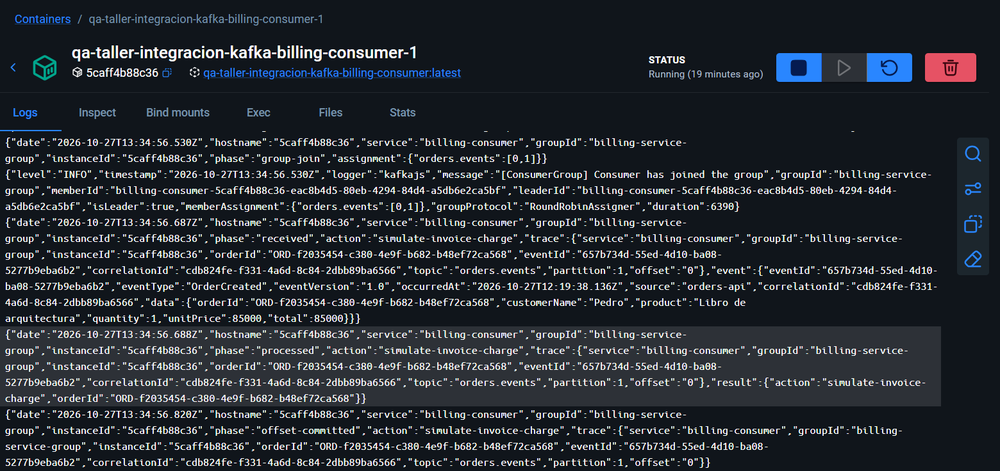
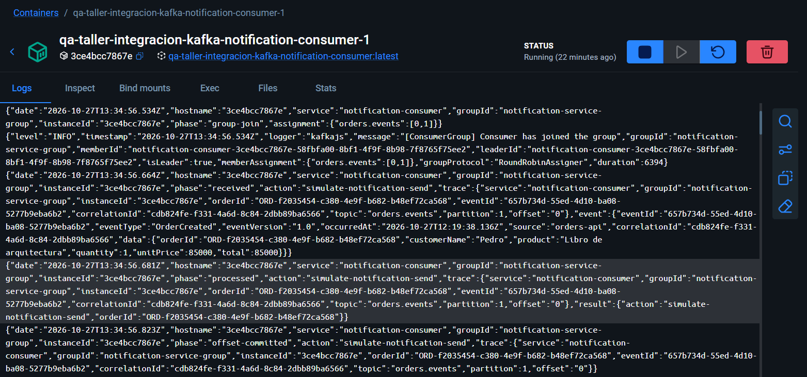

# CP-06 — Trazabilidad del flujo

## ID del caso
CP-06. Revisión documental de ejecución histórica del 27 de octubre de 2026; no se repitió el flujo.

## Arquitectura
Kafka: `orders-api` → log persistente `orders.events` → inventario, facturación y notificaciones en grupos independientes.

## Objetivo
Seguir un mismo pedido (`orderId` / `correlationId`) en los logs de API, broker y consumidor, conforme a la guía p. 4.
En el broker se consulta el **log persistente de orders.events mediante su dump nativo**.

## Precondiciones
Registro histórico ya publicado en `orders.events`, partición 1/offset 0; consumidores iniciados después contra ese registro.
[Contexto histórico y estados posteriores](../../verificacion/consumidores/RESUMEN.md).
No se comprobó el estado live durante esta revisión; las acciones de negocio son simuladas.

## Datos de entrada
- `orderId`: `ORD-f2035454-c380-4e9f-b682-b48ef72ca568`.
- `eventId`: `657b734d-55ed-4d10-ba08-5277b9eba6b2`.
- `correlationId`: `cdb824fe-f331-4a6d-8c84-2dbb89ba6566`.
- Evento `OrderCreated`, versión `1.0`, origen `orders-api`, occurredAt `2026-10-27T12:19:38.136Z`.
- [Petición original](../../verificacion/api/primera-publicacion/corrida-01/request.json) y [respuesta original](../../verificacion/api/primera-publicacion/corrida-01/response.json); cantidad 1, precio y total 85000.

## Pasos ejecutados
1. La corrida histórica publicó un pedido y recogió el log de la API y el dump del segmento `orders.events-1/00000000000000000000.log` mediante `kafka-dump-log.sh --print-data-log`.
2. Posteriormente se iniciaron los tres consumidores y se archivaron logs y consultas nativas de grupos, sin otro POST.
3. Se conservaron [comandos de publicación](../../verificacion/api/primera-publicacion/corrida-01/commands.json) y [comandos de consumo](../../verificacion/consumidores/runtime-01/commands.json), con tiempos UTC y exitcodes originales.
4. En esta revisión offline se parseó cada JSON de log, el payload del dump y cada `trace` de las tres fases, comprobando IDs y posición del registro por campo.
5. Se contrastaron cuatro PNG originales y metadatos; se generó únicamente una selección visual derivada para lectura de API, dump y un consumidor.

## Resultado esperado
Un mismo pedido y correlación identificables en API, registro persistido por el broker y logs del consumidor; posiciones y evento consistentes, sin confundir nombres de cabeceras con sus valores.

## Resultado obtenido
La API registra los tres IDs a **2026-10-27T12:19:38.456Z**, tópico `orders.events`, partición 1/baseOffset 0.
El dump nativo contiene key igual al pedido y payload JSON con la misma terna; registro offset 0, lote `isvalid: true`.
`headerKeys: [correlationId,eventId]` acredita nombres, no valores; la correlación se comprueba en el **payload**.
Los tres consumidores tienen esos IDs explícitos dentro de `trace` en `received` → `processed` → `offset-committed`, tópico/partición/offset `orders.events`/1/0.

| Servicio / grupo | Instancia | received → processed → offset-committed (27 de octubre, UTC) |
| --- | --- | --- |
| inventory-consumer / inventory-service-group | b8d3a808fc2c | 13:34:57.080 → 13:34:57.080 → 13:34:57.091 |
| billing-consumer / billing-service-group | 5caff4b88c36 | 13:34:56.687 → 13:34:56.688 → 13:34:56.820 |
| notification-consumer / notification-service-group | 3ce4bcc7867e | 13:34:56.664 → 13:34:56.681 → 13:34:56.823 |

Las consultas nativas históricas muestran siguiente offset 1/log-end 1/lag 0 en partición 1; el registro procesado sigue siendo offset 0.
La publicación y consumo están separados por aproximadamente 75 minutos y el arranque de grupos: no se presenta un pipeline instantáneo.

## Evidencia (capturas)

Registros de API, log persistente del broker e inventario: [manifest de extracción, rutas, rangos y SHA-256](manifest.json). Fuentes completas intactas, incluidos avisos y errores.

[Metadatos del evento](../../verificacion/api/primera-publicacion/corrida-01/capturas/01-order-created-kafka-ui.json): registrado el 27 de octubre; el tópico no es visible en el recorte, se acredita con el dump y API.

Estos tres PNG fueron registrados el **31 de octubre**, pero muestran logs del **27 de octubre**; metadatos y hashes referenciados en el manifest.
[API completa](../../verificacion/api/primera-publicacion/corrida-01/api-logs-stdout.txt) · [dump nativo completo](../../verificacion/api/primera-publicacion/corrida-01/broker-native-log-stdout.txt).
[Inventario completo](../../verificacion/consumidores/runtime-01/inventory-consumer-logs-stdout.txt) · [facturación completa](../../verificacion/consumidores/runtime-01/billing-consumer-logs-stdout.txt) · [notificaciones completas](../../verificacion/consumidores/runtime-01/notification-consumer-logs-stdout.txt).
[Resultados y offsets históricos por grupo](../../verificacion/consumidores/runtime-01/result.json).

## Estado
**Cumple**, conclusión técnica propia para CP-06, no calificación del profesor.
Kafka queda en **4/10** reportes cerrados: CP-01, CP-04, CP-05 y CP-06; seis pendientes (CP-07 a CP-12).

## Análisis técnico
La concordancia por campo y posición permite seguir el mismo registro; no se infiere identidad por proximidad de líneas ni por contadores.
La identidad en el broker se verifica en el payload del registro persistente, junto con su key, partición y offset; no se deduce únicamente de los nombres de cabeceras.
Se conservan `TimeoutNegativeWarning`, errores iniciales de creación de tópico y coordinador no disponible; los registros posteriores prueban publicación y procesamiento, no ausencia de incidentes ni su causa raíz.
Las responsabilidades simulan reserva, facturación y notificación; no se acreditan efectos comerciales, exactly-once ni ausencia universal de pérdida.
No se mezcla el pedido `ORD-d8484470...` publicado el 31 de octubre con consumidores históricos. CP-01/04/05 permanecen intactos.
No se cierra CP-07/08 por esta trazabilidad, ni recuperación, reparto intragrupo o los demás casos reactivos.
