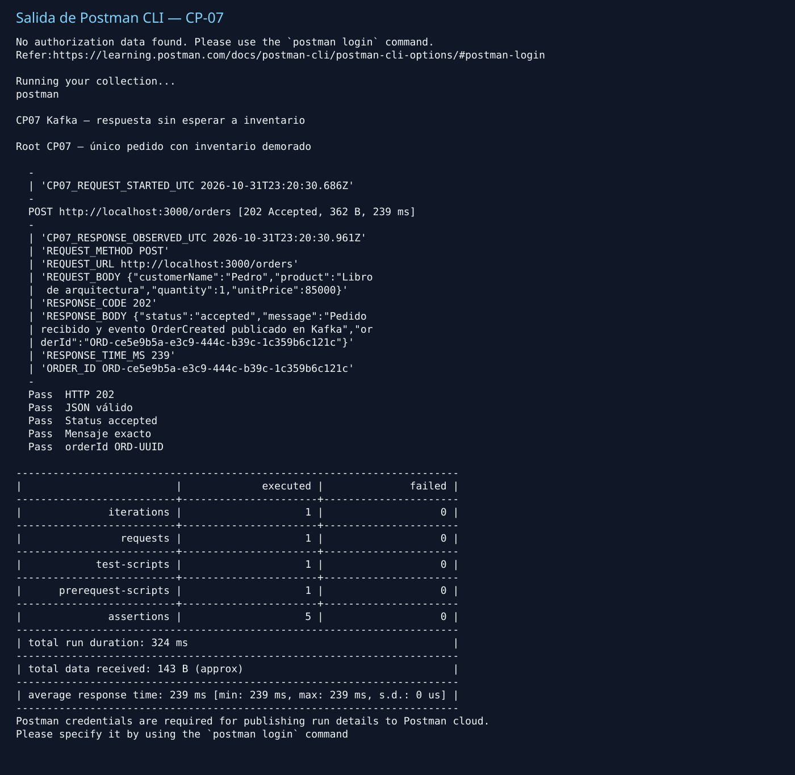
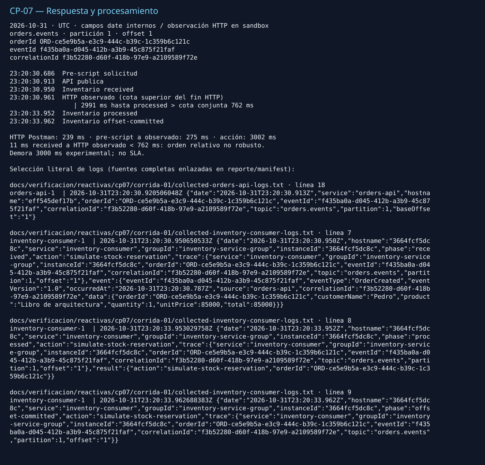

# CP-07 — Responsive

## ID del caso
CP-07. Corrida del 31 de octubre de 2026; cierre documental offline de una ejecución real ya terminada.

## Arquitectura
Kafka: `orders-api` → `orders.events` → tres consumidores en grupos independientes.

## Objetivo
Comprobar que la API **responde sin esperar al consumidor**, conforme a CP-07 de la guía. Comparar la respuesta HTTP con el fin de la acción simulada de inventario.

## Precondiciones
- Seis servicios activos; broker, API y consumidores saludables; UI activa. Inventario inicialmente con `PROCESSING_DELAY_MS=0`.
- Diseño experimental: una **publicación única** y dos recreaciones exclusivas de inventario (activar demora y restaurar), sin tocar los otros cinco servicios ni el broker/volumen.
- Demora opt-in ya existente de **3000 ms**, elegida como condición experimental para hacer observable el procesamiento; no es SLA ni exigencia numérica del profesor.
- Colección con un POST, una iteración, sin redirecciones ni reporte cloud; marcas UTC en pre-script y en la primera línea del script de respuesta. Se archivaron relojes antes, durante y después de la demora.

## Datos de entrada
`POST http://localhost:3000/orders`, `Content-Type: application/json`:

```json
{"customerName":"Pedro","product":"Libro de arquitectura","quantity":1,"unitPrice":85000}
```

- Pedido: `ORD-ce5e9b5a-e3c9-444c-b39c-1c359b6c121c`.
- Evento: `f435ba0a-d045-412b-a3b9-45c875f21faf`.
- Correlación: `f3b52280-d60f-418b-97e9-a2109589f72e`.
- `OrderCreated`, versión `1.0`, origen `orders-api`, occurredAt `2026-10-31T23:20:30.787Z`; total 85000.
- Posición observada en API y consumidores: `orders.events`, partición **1**, offset **1**.
- [Colección efectivamente ejecutada](../../verificacion/reactivas/cp07/corrida-01/collection-executed.json), preservada byte a byte.

## Pasos ejecutados
1. Se archivaron fuentes, configuración base, seis identidades/estados y relojes iniciales (`before`).
2. Se recreó únicamente inventario usando el override experimental de 3000 ms (`slow`), con su misma imagen, mounts y demás entorno.
3. Postman CLI ejecutó una sola vez la colección: un POST y una iteración (`publish`); se conservaron comando, stdout/stderr y código de salida.
4. Antes de restaurar se recogieron logs completos de API y tres consumidores, consultas de offsets y relojes (`collect`). Se correlacionaron tres IDs y posición en las nueve trazas.
5. Se recreó únicamente inventario con Compose base, restituyendo demora 0 y salud healthy (`restore`). Se comprobaron cinco servicios restantes idénticos y 333 hashes originales intactos (`verify`).
6. Este cierre reutiliza esos datos offline, sin solicitudes, operaciones de servicios ni modificación de originales. [Resultado original](../../verificacion/reactivas/cp07/corrida-01/result.json); [comando de publicación](../../verificacion/reactivas/cp07/corrida-01/publish-03-command.json).

## Resultado esperado
Respuesta de la API sin esperar al fin del procesamiento del consumidor. Como control observacional propio, comparar tiempos y una cota conservadora de incertidumbre de relojes; la guía no impone un máximo de latencia ni relojes perfectos.

## Resultado obtenido
HTTP **202 Accepted**, `status: accepted`, mensaje «Pedido recibido y evento OrderCreated publicado en Kafka», **239 ms medidos por Postman**, cinco aserciones aprobadas, una solicitud/iteración, CLI exit 0.

| Hito | Fecha y hora UTC (2026-10-31) | Origen |
| --- | --- | --- |
| Inicio pre-script | 23:20:30.686Z | CLI |
| Publicación API | 23:20:30.913Z | campo `date` del log API |
| Inventario received | 23:20:30.950Z | campo `date` del log inventario |
| HTTP observado | 23:20:30.961Z | primera línea del script de respuesta |
| Inventario processed | 23:20:33.952Z | campo `date` del log inventario |
| Inventario offset-committed | 23:20:33.962Z | campo `date` del log inventario |

Acción observada: **3002 ms**. HTTP observado → processed: **2991 ms**, mayor que la cota conservadora conjunta de **762 ms**. El intervalo pre-script → observación es **275 ms**, distinto de los 239 ms HTTP; ninguno es la duración del proceso CLI. HTTP observado es una cota superior del fin HTTP en el sandbox, no la salida del CLI.

Los 11 ms nominales entre received y HTTP observado son menores que la cota: **no permiten afirmar robustamente que inventario ya procesaba cuando respondió**. Sí se observa respuesta anterior al fin de su acción con separación superior a esa cota.

Restauración documentada: inventario healthy, `PROCESSING_DELAY_MS=0`, nuevo ID registrado `24326effb3e1…` (original `b8d3a808fc2c…`, experimental `3664fcf5dc8c…`). Los cinco IDs restantes se conservaron: API `eff545def17b…`, Kafka `8719d42973a5…`, UI `5a51c1295022…`, facturación `5caff4b88c36…`, notificaciones `3ce4bcc7867e…`; también entorno, imágenes, mounts y StartedAt idénticos. Código/Compose base y volumen del broker intactos. [Antes](../../verificacion/reactivas/cp07/corrida-01/before.json) · [demorado](../../verificacion/reactivas/cp07/corrida-01/delayed.json) · [restaurado](../../verificacion/reactivas/cp07/corrida-01/restored.json).

## Evidencia (capturas)


[Manifest de procedencia, selección, conversiones y SHA-256](manifest.json).
Vistas derivadas de stdout y logs archivados; sus originales completos se conservan sin reescritura:
[stdout CLI íntegro](../../verificacion/reactivas/cp07/corrida-01/publish-03-stdout.txt) · [API](../../verificacion/reactivas/cp07/corrida-01/collected-orders-api-logs.txt) · [inventario](../../verificacion/reactivas/cp07/corrida-01/collected-inventory-consumer-logs.txt) · [facturación](../../verificacion/reactivas/cp07/corrida-01/collected-billing-consumer-logs.txt) · [notificaciones](../../verificacion/reactivas/cp07/corrida-01/collected-notification-consumer-logs.txt).
[Relojes iniciales](../../verificacion/reactivas/cp07/corrida-01/before-clocks.json) · [relojes con demora](../../verificacion/reactivas/cp07/corrida-01/slow-clocks.json) · [relojes tras recogida](../../verificacion/reactivas/cp07/corrida-01/collect-clocks.json).

## Estado
**Cumple**, conclusión técnica propia para CP-07, no calificación del profesor. La respuesta observada precede al fin del procesamiento simulado de inventario.

## Análisis técnico
La demora controlada permite distinguir aceptación/publicación de finalización del consumidor. Se usan los campos `date` internos, sin confundirlos con timestamps externos de Compose. La cota suma, para API e inventario, el máximo de diferencias absolutas entre reloj de contenedor y extremos de ventana host, más margen local de 100 ms por servicio, sobre las tres muestras. Es un control conservador experimental con muestreo, no garantía universal de sincronización.

Los tres consumidores registran received, processed y offset-committed para la misma terna y posición; no se exige exactly-once. La comparación temporal decisiva es con inventario demorado, no con el fin de todos los consumidores. Los avisos CLI de credenciales/cloud permanecen en la imagen: no hubo login ni reporte cloud (`--no-report-events`). Los logs completos conservan warnings y errores históricos; no se afirma causa raíz ni ejecución libre de incidentes.

La evidencia respalda esta corrida, no una promesa de latencia, SLA, failover, CP-09, recuperación ni reparto intragrupo. Las acciones son simuladas. Las pruebas auxiliares y unitarias no sustituyen esta integración.
