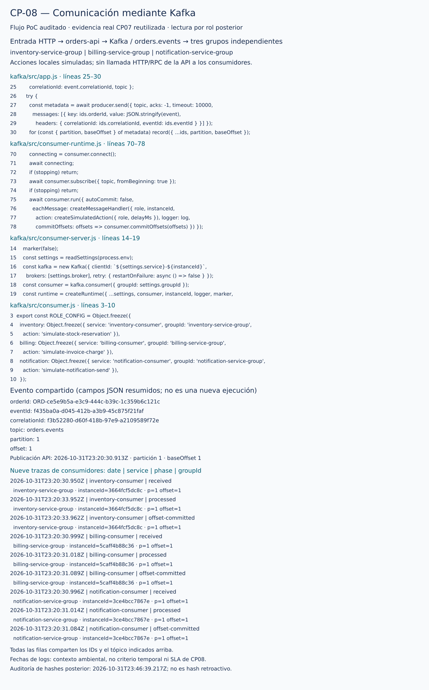

# CP-08 — Message-driven

## ID del caso
CP-08. Cierre documental del flujo PoC inspeccionado; reutiliza una ejecución real de CP-07, sin nueva publicación.

## Arquitectura
Kafka: entrada HTTP → `orders-api` → `orders.events` → `inventory-consumer`, `billing-consumer` y `notification-consumer`, cada uno en un grupo independiente.

## Objetivo
Verificar «No existe comunicación directa entre servicios» (guía, CP-08), dentro del flujo de negocio PoC auditado: la API publica mediante Kafka y los consumidores se suscriben al broker; no hay HTTP/RPC de la API a inventario, facturación ni notificaciones en el código inspeccionado. No se afirma ausencia universal de llamadas en dependencias o código no auditado.

## Precondiciones
- Corrida CP-07 terminada y restaurada; evidencia original compartida conservada, sin copiarla ni modificar su `result.json`.
- Fuentes actuales de los seis módulos JavaScript, Dockerfile, Compose y paquetes disponibles para lectura. API: `server.js` → `app.js` → `order-event.js`; consumidores: `consumer-server.js` → `consumer-runtime.js` → `consumer.js`.
- [Auditoría por rol](../../verificacion/reactivas/cp08/auditoria-01/lectura-por-rol-01/verification.json): PASS, verificada **2026-10-31T23:46:39.217Z**, posterior a la publicación **2026-10-31T23:20:30.913Z**. Son momentos distintos: los hashes actuales no son una medición instantánea retroactiva.
- La auditoría registra cuatro contenedores de negocio, doce comparaciones relevantes (tres por rol), 501 hashes originales preservados y seis snapshots coincidentes con CP-07 restaurado en ID, imagen, entorno, mounts y StartedAt. Inventario tiene el ID restaurado, distinto del previo al rollback; su imagen coincide con la experimental y restaurada.

## Datos de entrada
No hay entrada nueva. Se reutiliza el pedido de CP-07, con `customerName=Pedro`, `product=Libro de arquitectura`, `quantity=1`, `unitPrice=85000`:

| Campo | Valor observado |
| --- | --- |
| orderId | `ORD-ce5e9b5a-e3c9-444c-b39c-1c359b6c121c` |
| eventId | `f435ba0a-d045-412b-a3b9-45c875f21faf` |
| correlationId | `f3b52280-d60f-418b-97e9-a2109589f72e` |
| Evento | `OrderCreated`, versión `1.0`, origen `orders-api` |
| Posición | `orders.events`, partición `1`, offset `1` |

[Publicación original](../../verificacion/reactivas/cp07/corrida-01/publish-03-command.json) · [resultado original](../../verificacion/reactivas/cp07/corrida-01/result.json).

## Pasos ejecutados
1. Se revisaron la guía y las fuentes completas del flujo y su configuración, sin cargar los entrypoints de aplicación. Se distinguió el servidor HTTP de entrada de la suscripción KafkaJS real.
2. Se revisaron los registros de lectura existentes: filesystem y crypto dentro de Node, sin cargar la aplicación; ninguna solicitud HTTP adicional, reinicio ni cambio de configuración. La revisión documental no repitió Docker ni esos comandos.
3. Se conservó el primer recolector global **job 9 FAILED, exit 1**, cuya causa histórica sigue desconocida. Su probe de inventario `lectura-runtime/03-*`, exit 0, produjo ocho hashes: tres módulos relevantes y cinco archivos extra. El [diagnóstico offline](../../verificacion/reactivas/cp08/auditoria-01/diagnostico-fallo-01/offline-result.json) verifica JSON válido de 692 bytes y ocho coincidencias locales mediante VM, sin procesos. La revisión documental sólo consultó ese diagnóstico existente, sin repetir `repro.cjs` ni convertir el fallo global en PASS.
4. Se conservó **job 10 FAILED, exit 1**: ENOENT de `/app/src/consumer-runtime.js` en la API, por exigir módulos ajenos a su rol. Se preservan `failure.json`, stderr y comando fallido; no fue un fallo de la aplicación.
5. Se revisó **job 11 PASS, exit 0**: criterio corregido según entrypoint/imports, sin reconstruir imágenes. Reutiliza inventario y añade tres lecturas exitosas para API, facturación y notificaciones. Los tres módulos de cada rol coinciden con las fuentes locales; estas y Dockerfile/Compose coinciden con el subconjunto pertinente de CP-07 `sources-before.json`.
6. Se correlacionó la publicación API con las nueve trazas JSON de CP-07: received, processed y offset-committed por cada uno de los tres grupos, conservando terna de IDs, tópico, partición y offset.
7. Se archivaron copias byte-idénticas de la auditoría y las fuentes, junto con la vista SVG y el manifest de procedencia. La evidencia compartida de CP-07 permanece en su ubicación original y no se modificó.

## Resultado esperado
Comunicación del flujo de negocio mediada por Kafka: publicación en `orders.events` y consumo real KafkaJS por grupos independientes, sin invocaciones directas API–consumidores ni entre consumidores en el código auditado. Docker o un tópico configurado por sí solos no prueban esta propiedad.

## Resultado obtenido
La API llama a `producer.send` con el evento serializado; `server.js` establece tópico/broker y conecta el productor. Cada proceso consumidor crea `kafka.consumer({ groupId })`; el runtime ejecuta `consumer.subscribe` y `consumer.run` con `eachMessage`. El handler registra las tres fases y confirma offsets tras una acción **local simulada**, no una operación empresarial real.

La publicación API y las nueve trazas compartidas corresponden a la misma terna y posición. Los grupos son `inventory-service-group`, `billing-service-group` y `notification-service-group`. El grafo de imports inspeccionado no invoca servicios de negocio por HTTP/RPC. El HTTP de entrada y el healthcheck local de la propia API no son llamadas directas entre servicios de negocio. El readiness de consumidores es un archivo; bootstrap/admin se comunica con Kafka. `EXPOSE 3000` en Dockerfile no prueba un servidor HTTP en los consumidores.

## Evidencia (capturas)

Vista de código y trazas JSON archivadas, con extracciones y procedencia verificables. [Manifest de hashes, rangos y transformaciones](manifest.json).

[Auditoría por rol](../../verificacion/reactivas/cp08/auditoria-01/lectura-por-rol-01/verification.json) · [registros de recolección](../../verificacion/reactivas/cp08/auditoria-01/recibos-globales/manifest.json) · [fuentes copiadas](../../verificacion/reactivas/cp08/auditoria-01/fuentes-codigo/kafka/src/app.js).

Logs compartidos, íntegros y sin nueva recogida: [API](../../verificacion/reactivas/cp07/corrida-01/collected-orders-api-logs.txt), [inventario](../../verificacion/reactivas/cp07/corrida-01/collected-inventory-consumer-logs.txt), [facturación](../../verificacion/reactivas/cp07/corrida-01/collected-billing-consumer-logs.txt), [notificaciones](../../verificacion/reactivas/cp07/corrida-01/collected-notification-consumer-logs.txt). [Estado restaurado CP-07](../../verificacion/reactivas/cp07/corrida-01/restored.json).

## Estado
**Cumple**, conclusión técnica propia para la exigencia Message-driven de la guía en el flujo PoC auditado, no calificación del profesor ni certificación universal de todas las dependencias.

## Análisis técnico
Se combina inspección estática del flujo completo, configuración, coincidencias de módulos realmente utilizados por cada rol y trazas de una integración real previa. Las coincidencias de snapshots enlazan la lectura posterior con el estado restaurado de CP-07; no convierten el hash posterior en observación contemporánea de la publicación. Los dos intentos fallidos de recolección son parte de la evidencia y no se esconden ni se atribuyen a la aplicación.

La tabla visual resume campos JSON, conservando originales y procedencia. Sus fechas son contexto ambiental: no se reutiliza la comparación temporal Responsive como criterio de CP-08, ni se promete latencia o SLA. No se infieren CP-09, resiliencia, recuperación, reparto intragrupo, ausencia universal de pérdida ni exactly-once. Tres grupos independientes no equivalen a tres réplicas del mismo grupo. La revisión documental no creó pedidos ni ejecutó nuevas pruebas de integración.
