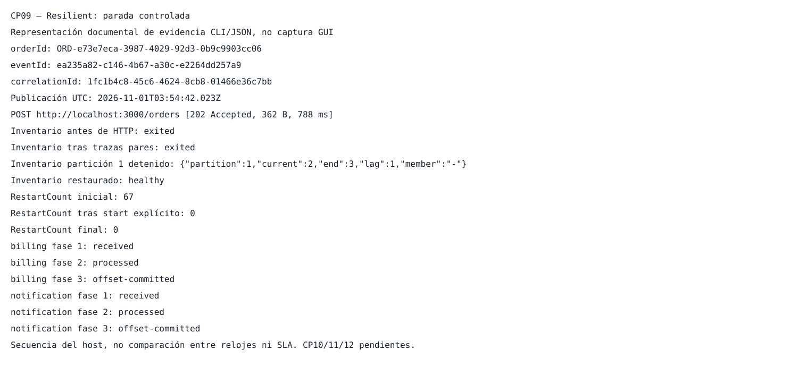

# CP-09 — Resilient

## ID del caso
CP-09. Corrida real 01 del 1 de noviembre de 2026; cierre documental posterior, sin nueva ejecución runtime.

## Arquitectura
Kafka: HTTP → orders-api → orders.events → tres consumidores en grupos independientes. Se retira únicamente inventory-consumer mediante parada controlada; no se provoca caída del broker.

## Objetivo
Verificar «El sistema soporta caída del consumidor» (guía, CP-09): continuidad de aceptación/publicación y de los otros consumidores durante indisponibilidad controlada de inventario. No es una prueba de crash abrupto, alta disponibilidad del broker ni tolerancia a cualquier fallo.

## Precondiciones
- Preflight real PASS, 2026-11-01T03:51:31.990Z; seis contenedores running, API/broker/consumidores healthy y UI running. Delay de procesamiento 0; un consumidor por grupo, dos particiones, pipeline existente.
- Grupos inventory-service-group, billing-service-group y notification-service-group con lag 0; partición 1 current/end=2/2 y partición 0=1/1.
- Secuencia experimental: un stop con --time 15, un POST de una iteración sin redirecciones y un start sobre el mismo ID. Registros originales conservados.
- [Verificación inicial y registros](../../verificacion/reactivas/cp09/corrida-01/control/cp09-preflight-real-01/validation-parent.json); [fuentes previas al runtime](../../verificacion/reactivas/cp09/corrida-01/runtime/sources-before.json). La verificación independiente documenta el estado de las fuentes y del entorno en el momento de la ejecución; no se repitió durante la revisión documental.

## Datos de entrada
customerName=Pedro CP09; product=Libro de arquitectura; quantity=1; unitPrice=85000. [Colección realmente ejecutada](../../verificacion/reactivas/cp09/corrida-01/runtime/collection-executed.json).

| Campo | Valor observado |
| --- | --- |
| orderId | ORD-e73e7eca-3987-4029-92d3-0b9c9903cc06 |
| eventId | ea235a82-c146-4b67-a30c-e2264dd257a9 |
| correlationId | 1fc1b4c8-45c6-4624-8cb8-01466e36c7bb |
| Posición | orders.events, partición 1, offset 2 |
| Publicación UTC | 2026-11-01T03:54:42.023Z |

## Pasos ejecutados
1. Se ejecutó el preflight real original, exit 0; cinco comandos internos. La revisión documental consultó sus registros sin repetir la ejecución.
2. El host completó stop --time 15 del ID 24326effb3e116ec43a53b3353bdf8a00c86186902832b7bcb865cdfe3311978: 2026-11-01T03:54:35.495Z → 2026-11-01T03:54:37.609Z. Se verificó inventario exited y grupo vacío antes de HTTP.
3. Se ejecutó exactamente una iteración POST con Postman CLI y --ignore-redirects: 2026-11-01T03:54:38.391Z → 2026-11-01T03:54:42.730Z. El stdout real acredita HTTP 202 Accepted; se correlacionó la publicación API con los IDs y posición indicados.
4. Con inventario aún exited, se recogieron las seis trazas de los pares, los offsets y el segundo snapshot. StartedAt/FinishedAt de inventario coinciden entre ambos snapshots; los otros cinco servicios mantienen IDs, configuración, StartedAt y RestartCount.
5. Como limpieza se ejecutó un start explícito del mismo ID: 2026-11-01T03:54:47.400Z → 2026-11-01T03:54:47.895Z; inventario volvió a healthy, registró sus tres fases y los grupos quedaron en lag 0. No hubo otro POST.
6. La verificación independiente offline de la ejecución se registró a 2026-11-01T03:55:52.704Z: PASS, 42 comandos internos exit 0 sin signal/error. Ejecución global original: 03:54:35.137168 → 03:54:54.765315 UTC, exit 0. Las copias archivadas son byte-idénticas; la revisión documental fue offline, sin repetir operaciones de infraestructura.

## Resultado esperado
La indisponibilidad de inventario no impide aceptar/publicar el pedido ni procesarlo en facturación y notificaciones. Se registra la ventana de parada y se restaura el entorno.

## Resultado obtenido
HTTP 202 Accepted observado en Postman CLI. Publicación confirmada en orders.events partición 1/offset 2, delta del end offset 2→3 durante inventario detenido. En esa ventana inventario conserva current=2, end=3, lag=1, sin miembro; facturación y notificaciones avanzan a current=3, end=3, lag=0.

| Consumidor | Fase | UTC registrada por servicio |
| --- | --- | --- |
| billing | received | 2026-11-01T03:54:42.868Z |
| billing | processed | 2026-11-01T03:54:42.878Z |
| billing | offset-committed | 2026-11-01T03:54:43.609Z |
| notification | received | 2026-11-01T03:54:42.880Z |
| notification | processed | 2026-11-01T03:54:42.895Z |
| notification | offset-committed | 2026-11-01T03:54:43.618Z |

La ventana se prueba por secuencia de comandos del host y [snapshot previo a HTTP](../../verificacion/reactivas/cp09/corrida-01/runtime/window-before-http.json) frente a [snapshot posterior a las trazas](../../verificacion/reactivas/cp09/corrida-01/runtime/collected.json), no por diferencias de milisegundos entre relojes. Inventario conserva StartedAt=2026-11-01T02:56:10.259148177Z y FinishedAt=2026-11-01T03:54:37.235196137Z mientras está exited.

Restauración: mismo ID, imagen, entorno, mounts y configuración; healthy. Inventario registra received 2026-11-01T03:54:51.334Z; processed 2026-11-01T03:54:51.334Z; offset-committed 2026-11-01T03:54:51.341Z. Los tres grupos terminan partición 1 current/end=3/3, lag=0 (delta 1), y partición 0=1/1, lag=0. RestartCount de inventario pasa de 67 a 0 al start explícito observado; se usa la captura inmediatamente posterior como referencia, y permanece 0 con StartedAt=2026-11-01T03:54:47.541949099Z estable hasta el final. No se exige que el contador final sea 67 ni se interpreta el reinicio explícito como recreación o como 67 reinicios durante la prueba. Los otros cinco servicios permanecen intactos.

## Evidencia (capturas)

**Representación documental de evidencia CLI/JSON, no captura GUI.** SVG estático con escape XML; sin revisión raster/GUI afirmada. [Manifest de copias, SHA-256 y procedencia](manifest.json).

[HTTP stdout original](../../verificacion/reactivas/cp09/corrida-01/runtime/run-0007-stdout.txt) · [comando HTTP](../../verificacion/reactivas/cp09/corrida-01/runtime/run-0007-command.json) · [dataset recopilado: logs separados por servicio](../../verificacion/reactivas/cp09/corrida-01/runtime/collected.json) · [restauración y logs](../../verificacion/reactivas/cp09/corrida-01/runtime/restored-complete.json) · [verificación independiente de la ejecución](../../verificacion/reactivas/cp09/corrida-01/control/cp09-run-real-01/validation-parent.json) · [resultado runtime original](../../verificacion/reactivas/cp09/corrida-01/runtime/result.json) · [validación documental](validacion.json) · [verificación de consistencia documental](validacion-integrada.json).

## Estado
**Cumple**, conclusión técnica propia para CP-09 mediante parada controlada de un consumidor; no calificación del profesor ni certificación universal de resiliencia.

## Análisis técnico
La API publica y los otros grupos procesan sin depender de la disponibilidad de inventario. HTTP 202 se acompaña de publicación, delta de offsets y seis trazas correlacionadas, no de contadores aislados. Las acciones de negocio son simuladas. Los snapshots enmarcan una secuencia del host: no son medición atómica del clúster ni prueba basada en un supuesto orden entre relojes de servicio. No se infiere un fin HTTP absoluto, una ventaja de 11 ms ni un SLA a partir de las fechas.

La restauración y sus tres trazas son limpieza documentada de CP-09; no cierran CP-11/12, ni demuestran ausencia universal de pérdida, exactly-once o recuperación tras crash/broker caído. CP-10/11/12 cuentan con una ejecución independiente posterior, descrita en sus reportes; no se atribuyen a esta corrida. Observación administrativa 04 y referencias legacy 03 se conservan como procedencia, no se convierten retroactivamente en una ejecución CP-09. Fuentes y fallos históricos no se reescriben. La revisión documental no añade pruebas funcionales nuevas.
