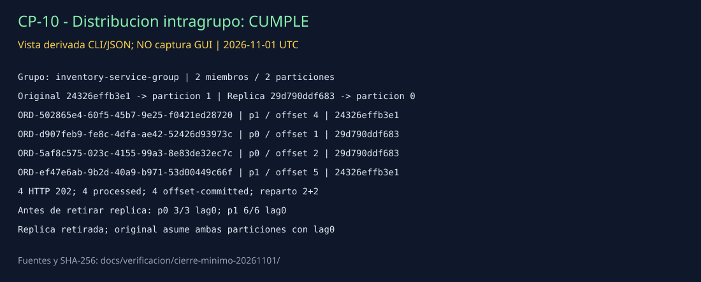

# CP-10 — Elastic: distribución entre dos consumidores

## ID del caso
CP-10. Ejecución mínima real del 1 de noviembre de 2026 (UTC).

## Arquitectura
Kafka, tópico `orders.events` con dos particiones. Dos instancias de inventario pertenecen al mismo `inventory-service-group`; facturación y notificaciones son grupos independientes y no se cuentan como réplicas de inventario.

## Objetivo
Verificar la distribución de carga con múltiples consumidores, según CP-10 de la guía.

## Precondiciones
- Broker y API existentes en ejecución; inventario recuperado mediante la corrida CP-11/12 inmediatamente anterior.
- Una única réplica temporal creada desde la misma imagen local `sha256:8678df89f52018880ad6fa71a5ce8932743d3998c3a68243f1dbf0e4c10d8ab6`, sin build ni descarga.
- Consulta nativa previa al lote acredita dos miembros: original `24326effb3e1` asignado a partición 1 y réplica `29d790ddf683` a partición 0.
- Alcance experimental: una réplica, hasta ocho pedidos entre todos los casos y limpieza únicamente de la réplica. Se utilizaron cinco pedidos en total, cuatro en este caso.

## Datos de entrada
Cuatro `POST /orders` mediante curl: `customerName=Prueba CP10 1..4`, `product=Reparto minimo Kafka`, `quantity=1`, `unitPrice=100`. Se conservan los cuatro cuerpos y respuestas sin modificar.

## Pasos ejecutados
1. Crear `kafka-cp10-minima-20261101` con la imagen local de inventario, red existente y el mismo rol, tópico y broker.
2. Consultar `kafka-consumer-groups.sh --describe --group inventory-service-group --members --verbose`; conservar imagen y entorno de ambas instancias.
3. Enviar cuatro pedidos, cada uno una sola vez, a las 05:16:57 UTC.
4. Recoger logs originales de API y de ambas instancias; correlacionar `orderId`, `eventId`, `correlationId`, partición y offset.
5. Consultar offsets con ambas instancias activas; detener y retirar solamente la réplica temporal.
6. Confirmar que el inventario original asume ambas particiones, con lag cero. Validar offline las evidencias.

## Resultado esperado
Los pedidos se reparten entre ambas instancias del mismo grupo según sus particiones. Se procesa y confirma cada pedido observado, sin confundir difusión entre grupos con distribución intragrupo.

## Resultado obtenido
Cuatro respuestas HTTP 202. Cada pedido tiene exactamente una fase `received`, una `processed` y una `offset-committed` en los logs recogidos de las dos instancias.

| Pedido (`orderId`) | Partición / offset | Instancia |
| --- | --- | --- |
| ORD-502865e4-60f5-45b7-9e25-f0421ed28720 | 1 / 4 | 24326effb3e1 |
| ORD-d907feb9-fe8c-4dfa-ae42-52426d93973c | 0 / 1 | 29d790ddf683 |
| ORD-5af8c575-023c-4155-99a3-8e83de32ec7c | 0 / 2 | 29d790ddf683 |
| ORD-ef47e6ab-9b2d-40a9-b971-53d00449c66f | 1 / 5 | 24326effb3e1 |

Reparto observado: **dos pedidos por instancia**. Offsets finales con dos miembros: partición 0 current/end=3/3, partición 1=6/6, ambos lag=0. La réplica terminó con exit 0 y fue retirada; el mismo inventario original quedó con ambas particiones y lag=0.

## Evidencia (capturas)

**Vista derivada de CLI/JSON, no captura GUI ni imagen de Postman.** [Evidencia completa y comandos](../../verificacion/cierre-minimo-20261101/RESUMEN.md) · [miembros y asignaciones](../../verificacion/cierre-minimo-20261101/cp10-miembros.stdout.txt) · [imagen y entorno](../../verificacion/cierre-minimo-20261101/cp10-imagen-env.txt) · [logs original](../../verificacion/cierre-minimo-20261101/cp10-original.stdout.jsonl) · [logs réplica](../../verificacion/cierre-minimo-20261101/cp10-replica.stdout.jsonl) · [trazas correlacionadas](../../verificacion/cierre-minimo-20261101/resumen-trazas.json) · [validación](../../verificacion/cierre-minimo-20261101/validacion.json).

## Estado
**Cumple**, conclusión técnica propia para la distribución demostrada en esta prueba de concepto. No equivale a calificación del profesor. La evidencia presentada es CLI/JSON, no GUI.

## Análisis técnico
Kafka asigna cada partición a un único miembro del grupo. Dos particiones permiten dos consumidores con trabajo; añadir más no aumenta el paralelismo de este tópico. El reparto 2+2 es el resultado de este lote, no una garantía de equilibrio exacto en cualquier carga. Se demuestra escalado manual y distribución, no autoescalado, mejora de throughput ni exactly-once. No se cambiaron código, broker, volúmenes ni configuración persistente. Los intentos previos fallidos no se borran ni se presentan como exitosos.
