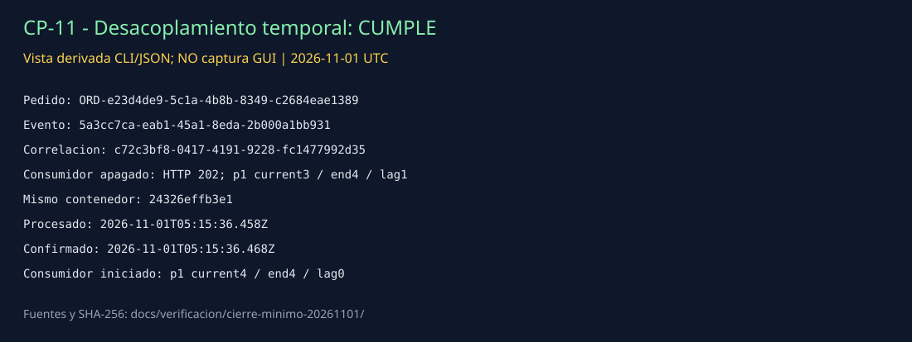

# CP-11 — Desacoplamiento temporal

## ID del caso
CP-11. Corrida mínima del 1 de noviembre de 2026; comparte un único pedido con CP-12.

## Arquitectura
Kafka: `orders-api` publica en `orders.events`; inventario consume mediante `inventory-service-group`. El productor no necesita un consumidor de inventario activo para publicar.

## Objetivo
Comprobar que un evento publicado con el consumidor apagado se procesa cuando este se inicia, según CP-11 de la guía.

## Precondiciones
- API y broker existentes en ejecución; API `/health` responde `{"status":"ok"}`.
- Inventario inicialmente figura healthy, pero su grupo no tiene miembros: no se interpreta el healthcheck como prueba de consumo.
- El procedimiento detiene y arranca el mismo inventario, sin recrearlo ni cambiar broker o volúmenes.
- No hay una segunda réplica durante esta prueba. La réplica de CP-10 se crea después.

## Datos de entrada
`POST /orders` con `customerName=Prueba CP11 CP12`, `product=Recuperacion minima Kafka`, `quantity=1`, `unitPrice=1200`.

| Identificador | Valor |
| --- | --- |
| orderId | ORD-e23d4de9-5c1a-4b8b-8349-c2684eae1389 |
| eventId | 5a3cc7ca-eab1-45a1-8eda-2b000a1bb931 |
| correlationId | c72c3bf8-0417-4191-9228-fc1477992d35 |
| Tópico / partición / offset | orders.events / 1 / 3 |

## Pasos ejecutados
1. Guardar ID e imagen de inventario y detenerlo con `docker stop --time 15`.
2. Verificar estado `exited`, exit 0, finalizado a las 05:15:15.104734579 UTC.
3. Enviar una petición mediante curl; conservar cuerpo, respuesta, cabeceras y duración. La API registra publicación a las 05:15:15.906 UTC.
4. Consultar el grupo antes de arrancar: partición 1 current=3, end=4, lag=1, sin miembro activo.
5. Arrancar el mismo contenedor; recoger sus fases de consumo y volver a consultar offsets.
6. Correlacionar offline los mismos identificadores entre respuesta, API y consumidor.

## Resultado esperado
La API acepta/publica con inventario apagado; el evento permanece disponible y es consumido después de iniciar inventario.

## Resultado obtenido
HTTP **202** con inventario apagado. El broker conserva un evento pendiente: partición 1 current/end=3/4, lag=1. Al iniciar el mismo inventario `24326effb3e1`, registra el mismo pedido:

| Fase | Fecha UTC |
| --- | --- |
| received | 2026-11-01T05:15:36.457Z |
| processed | 2026-11-01T05:15:36.458Z |
| offset-committed | 2026-11-01T05:15:36.468Z |

La consulta posterior muestra partición 1 current/end=4/4 y lag=0; partición 0 permanece en 1/1, lag=0.

## Evidencia (capturas)

**Vista derivada de CLI/JSON, no captura GUI.** [Resumen y comandos](../../verificacion/cierre-minimo-20261101/RESUMEN.md) · [estado apagado](../../verificacion/cierre-minimo-20261101/inventory-apagado.txt) · [respuesta HTTP](../../verificacion/cierre-minimo-20261101/pedido-pendiente.response.json) · [offsets pendiente](../../verificacion/cierre-minimo-20261101/pendiente-offsets.stdout.txt) · [logs recuperación](../../verificacion/cierre-minimo-20261101/recuperacion-inventory.stdout.jsonl) · [offsets recuperados](../../verificacion/cierre-minimo-20261101/recuperado-offsets.stdout.txt) · [validación](../../verificacion/cierre-minimo-20261101/validacion.json).

## Estado
**Cumple**, conclusión técnica propia. La evidencia presentada es CLI/JSON, no una captura GUI de Postman.

## Análisis técnico
La disponibilidad del consumidor no es precondición para publicar. Kafka retiene el registro y el grupo avanza su offset después de procesarlo. Se verifican identidad del evento y avance de offsets, no solamente disponibilidad HTTP. La ventana se sustenta en la secuencia stop → estado exited → POST → consulta de pendiente → start. Esta corrida no acredita salud de los otros grupos, disponibilidad indefinida fuera de la retención ni exactly-once.
