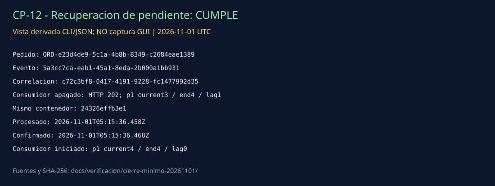

# CP-12 — Recuperación de evento pendiente

## ID del caso
CP-12. Ejecución real del 1 de noviembre de 2026, compartida con CP-11; no hubo un segundo pedido para este caso.

## Arquitectura
Kafka, log `orders.events` y offsets confirmados de `inventory-service-group`. Se reinicia el mismo consumidor, no el broker.

## Objetivo
Comprobar que, tras reiniciar el consumidor, un evento pendiente se procesa sin pérdida en la muestra observada. La guía permite reiniciar consumidor **o** broker y recuperar mensajes no confirmados **o** eventos pendientes; aquí se prueba la variante consumidor/pendiente.

## Precondiciones
- Broker y API permanecen activos.
- Inventario se detiene controladamente y queda `exited` antes de publicar el evento.
- La consulta durante la parada muestra partición 1 current=3, log-end=4 y lag=1, sin miembro activo: el evento está pendiente de ese grupo.
- Se conserva el contenedor original, su imagen y los datos del broker. No se resetean offsets ni se crea un grupo nuevo.

## Datos de entrada
Pedido de CP-11: `Prueba CP11 CP12`, `Recuperacion minima Kafka`, cantidad 1, precio 1200.

- `orderId`: `ORD-e23d4de9-5c1a-4b8b-8349-c2684eae1389`.
- `eventId`: `5a3cc7ca-eab1-45a1-8eda-2b000a1bb931`.
- `correlationId`: `c72c3bf8-0417-4191-9228-fc1477992d35`.
- Posición: `orders.events`, partición 1, offset 3.

## Pasos ejecutados
1. Detener inventario mediante `docker stop --time 15`, publicar un pedido y acreditar el pendiente mediante consulta nativa de offsets.
2. Registrar el ID completo antes y después de `docker start`: `24326effb3e116ec43a53b3353bdf8a00c86186902832b7bcb865cdfe3311978`.
3. Recoger logs del proceso iniciado; comprobar los mismos IDs y la misma posición en `received`, `processed` y `offset-committed`.
4. Consultar nuevamente el grupo: debe confirmar el siguiente offset, 4, y quedar sin lag.
5. Validar offline identidad del contenedor, publicación, fases y offsets. No repetir POST ni reiniciar broker.

## Resultado esperado
El evento pendiente antes del arranque se recupera, procesa y confirma; su identidad no cambia y el lag vuelve a cero.

## Resultado obtenido
**Un evento pendiente recuperado de uno probado.** El mismo contenedor se inicia y registra `received` a las 05:15:36.457 UTC, `processed` a las 05:15:36.458 y `offset-committed` a las 05:15:36.468. Las tres fases coinciden con API en `orderId`, `eventId`, `correlationId`, partición 1 y offset 3.

| Momento | Current offset | Log-end offset | Lag |
| --- | --- | --- | --- |
| Publicado, consumidor apagado | 3 | 4 | 1 |
| Consumidor iniciado y evento confirmado | 4 | 4 | 0 |

La partición 0 permanece current/end=1/1, lag=0 en ambas consultas. El offset confirmado es la posición siguiente al registro procesado; confirmar 4 corresponde al evento en offset 3.

## Evidencia (capturas)

**Vista derivada de CLI/JSON, no captura GUI.** [Corrida compartida y comandos](../../verificacion/cierre-minimo-20261101/RESUMEN.md) · [pendiente antes del arranque](../../verificacion/cierre-minimo-20261101/pendiente-offsets.stdout.txt) · [contenedor antes](../../verificacion/cierre-minimo-20261101/inventory-antes.txt) · [mismo contenedor reiniciado](../../verificacion/cierre-minimo-20261101/inventory-reiniciado.txt) · [logs originales](../../verificacion/cierre-minimo-20261101/recuperacion-inventory.stdout.jsonl) · [offsets posteriores](../../verificacion/cierre-minimo-20261101/recuperado-offsets.stdout.txt) · [trazas correlacionadas](../../verificacion/cierre-minimo-20261101/resumen-trazas.json) · [validación](../../verificacion/cierre-minimo-20261101/validacion.json).

## Estado
**Cumple**, conclusión técnica propia para recuperación del evento pendiente probado. La evidencia presentada es CLI/JSON, no una captura GUI.

## Análisis técnico
El grupo conserva su offset confirmado y lee el registro pendiente del log al incorporarse nuevamente. La evidencia acredita recuperación del mismo evento, no una comparación de cantidades sin identidad. Se comparte ejecución con CP-11 porque el escenario satisface ambos objetivos, diferenciados en los reportes. No se simula crash abrupto durante una acción de negocio, fallo de broker ni pérdida de discos; tampoco se demuestra ausencia universal de pérdidas, deduplicación o exactly-once. El código simula acciones de negocio, sin transacción atómica con sistemas externos.
